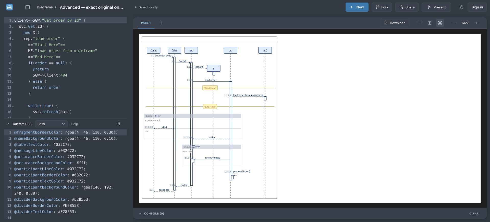
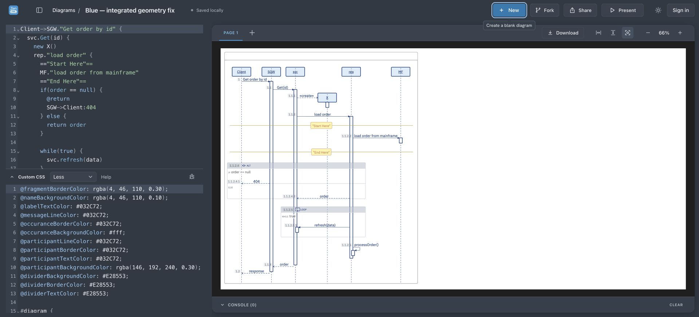

# Advanced data integration on official core 4.8.1

Read original in Chrome Conf App (on-disk Profile 8), without editing its data:
http://localhost:4441/?id=78909a11-0851-4b8e-9e5b-aad18d03c548

The original has the Advanced alignment repairs. The previous isolated audit browser could not access its storage; this follow-up resolves that limitation.

A separate candidate was created through the supported JSON Import UI with the exact DSL and CustomCSS read from the original:
http://localhost:4460/?id=advanced-core481-review-copy

Its compiled CSS is byte-identical to the original (3521 characters). Original source CSS and DSL are saved alongside this report. No original diagram data was modified. The copy retains the original's existing opaque participant-fill override; this is distinct from the fresh Blue template's translucent fill.

## Geometry parity

At 100% zoom, original core 4.7.2 and candidate core 4.8.1 returned identical measured bounds:

| Check | Both versions |
|---|---:|
| X activation / lifeline centre | 444.5 / 444.5 px |
| MF activation / lifeline centre | 750.5 / 750.5 px |
| Creation arrow tip / X left edge | 403.84375 / 404 px |
| Creation arrow centre / X centre | 205.5 / 206 px |
| X activation top / participant bottom | 224 / 226 px (2 px overlap) |

Raw measurements: original-vs-copy.geometry.json. Screenshot below uses Fit diagram after measurement and dark application appearance.

## Bundled Blue template integration

The original repair was not a reusable source fix: it used a fixed message width and a selector naming MF. The Blue template now compensates for its 2px border with 6px occurrence left padding instead of core's 7px default. This removes accumulated nesting drift for SGW, svc, rep and MF. Left-to-right creation line/arrow endpoints and vertical position are corrected while preserving core's name-dependent width calculation. Direct selectors avoid changing nested messages or reverse-direction creation arrows.

This changes bundled template CSS in web/src/domain/templates.ts. New Blue diagrams and exact legacy-template CSS upgrades receive it. Already-customized documents are not rewritten. Original data and official core remain unchanged.

Fresh corrected Blue copy in Conf App:
http://localhost:4460/?id=66903279-7f93-4fce-9ccd-68d3ed13025f

Measured in Chrome at 100%: arrow right404 = X left404; arrow centre206 = X centre206; X/MF activation centres444.5/750.5 match their lifelines; X activation top224 shares the participant's bottom226 border. All six participant fills remain rgba(146,192,240,0.3). Screenshot uses Fit diagram after measurement.

Validation: browser regressions first failed on the old geometry; 8 template browser tests now pass, including short/long creation names, nested activation centres, and unchanged translucent fill. 14 focused unit tests, TypeScript, web build and diff check pass.
