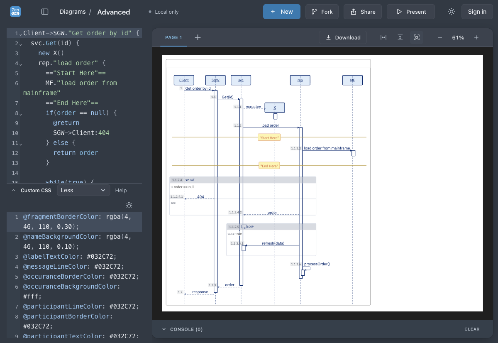
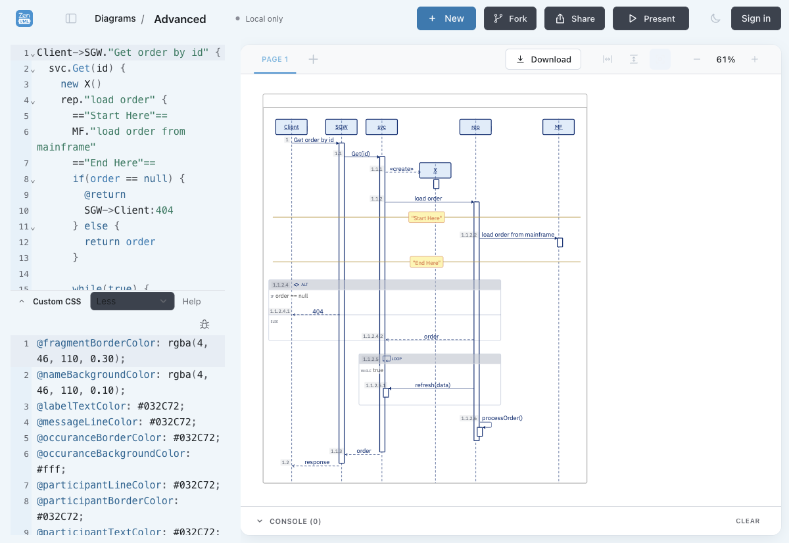

# Blue template baseline audit — 2026-10-21

## Source ancestry

PR840 merged as 359951636f9f4fb952f0d1a6ca7fe7196656c121 (head d2d1e2e1): template CSS compatibility, Welcome removal and missing-diagram notice.
PR842 merged as feff3ba6e35cec7b44458e7374a60fe38c47eafa: official core4.8.1 and native dark rendering/export.
PR843 implementation HEAD881dcc9a descends from both; origin/master is feff3ba6. Local master c2cb5d08 is stale. No merged source changes are missing. templates.ts is byte-identical to PR840 merge; no template asset changes are needed.

## Running servers

- 4441: PID19728, ui-integration worktree, production preview. Worktree HEADd2d1e2e1; core4.7.2. Loaded core asset zenuml-C8o49Lta.js matches installed core dist SHA25645120d40efdab49ae9d8175e80d06a83136647cc1bf04054a1dd7d38925e7435.
- 4458: PID30569, a5fa worktree, Vite development server.
- 4460: PID70602, a5fa worktree, production preview. index-CtVDwXkw.js, bootstrap B_b1rpUJ; core4.8.1 asset zenuml-C8lwBgt2.js matches installed core dist SHA25673a1c0713b31991af10cef690a1db0ef82e9d45ce7430edf0f6a38f3d8c35eb9.

Root/web manifests and both locks pin core4.8.1. Existing servers were reused; no user sessions restarted or worktrees reset.

## Fresh Blue template on candidate

Created through Diagrams → Blue, fit diagram, toggled dark/light and refreshed. Candidate URL http://127.0.0.1:4460/?id=20209e6c-76dc-4f7c-adbb-ba3b35900527 (local browser storage).

Dark chrome: diagram retains theme-default, white canvas, participant rgba(146,192,240,0.3), blue border rgb(3,44,114). The template's transparency and colors remain intact.

## Separate original Advanced repair

Original id78909a11-0851-4b8e-9e5b-aad18d03c548 was a saved-document CustomCSS repair, not a template source change. Its saved evidence is in /Users/pengxiao/workspaces/zenuml/web-sequence/artifacts/visual-review/: advanced-original-custom-css.less (backup), advanced-custom-css-repaired.less (repair), advanced-original-custom-css-final-independent.geometry.json and screenshot.

That repair includes document-specific creation-line/activation offsets and an opaque participant fill. These are absent from fresh Blue template CSS, as expected; copying the full repair into bundled Blue would change its existing transparency. No such copy was made.

Opening the original localhost:4441 URL in this audit browser displayed the missing-diagram notice: its data is not stored in this browser context. Thus the original document's current saved CSS could not be reverified here. The saved independent geometry report confirms the historical repair on core4.7.2; this audit does not claim it has been reproduced on4.8.1.

No source integration was required. PR843 remains the host first-paint change; core palette APIs in separate core PR509 remain out of scope. Production unchanged.
