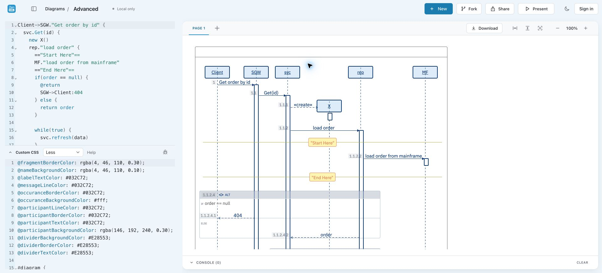
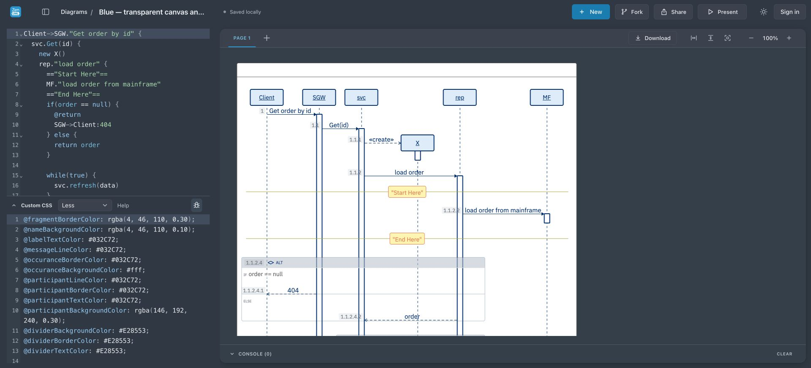
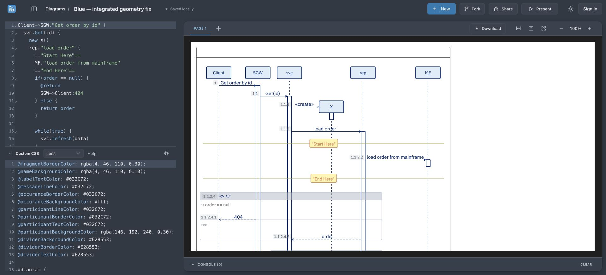

# Blue participant/lifeline correction

## Reproduction and runtime identity

The omitted acceptance criterion was reproduced in both builds: lifelines started at header tops (ordinary78px, created X186px), while translucent headers extended to118px and226px. Dashes were visible through header interiors. Prior arrow/activation alignment checks did not cover this.

Read chat “接入 WebSequence 原生深色渲染 (2)” 01a15c96-8732-77d3-b858-47abecb07309. Its worktree document-surface-contract is at8a285d62, including transparent Blue canvas55530f3d, with common ancestor feff3ba6 to this branch. It does not include Blue geometry commit e68ed90f. Port4467 PID91764 serves that worktree's web directory. Browser iframe script resolves directly to its node_modules core dist; package version4.8.1-local-outer-transparent, SHA256a1a443f2025622dc2d48fd66aa4d27e395b090f9233f9c269767d36417229db1.

The foreground Codex panel could not be read because the computer-use tool denies access to Codex itself. This report verifies the running4467 build in a separate Chrome tab, not the exact original foreground tab. No files in the other worktree or original user diagram were modified.

## Fix and evidence

Blue CSS defines --blue-participant-height:2.5rem, uses it for the participant height, and adds the same top margin to the flexing lifeline. The line begins below the header, keeps its lower endpoint, and does not need an opaque fill or renderer change. The shared variable also passed a3rem-height browser test. Arbitrary per-node height overrides must keep the line offset in step; automatic measurement of arbitrary CustomCSS heights is not claimed.

After on both runtimes: ordinary line top118px, created X226px; lower endpoints remain982px. Every participant retains rgba(146,192,240,0.3). Raw before/after measurements are committed.

## Review copies and migration

- Transparent runtime, separate imported fixture: http://127.0.0.1:4467/?id=blue-transparent-lifeline-review
- Existing saved Blue review copy, verified on reload: http://localhost:4460/?id=66903279-7f93-4fce-9ccd-68d3ed13025f

Links use Chrome Conf App local storage. transparent-review-copy.json is the importable input. It combines final Blue geometry/lifeline CSS with4467's existing transparent-canvas/white-frame declaration; it is a document fixture, not a source merge.

New Blue templates get the fix. Exact previously generated Blue CSS from before geometry and before this header fix migrates on load. Author-edited CSS is not rewritten. Original Advanced data has its own opaque header repair and remains unchanged.

## Cross-branch integration boundary

No merge, npm publish or deployment performed. To integrate into document-surface-contract, apply geometry commit e68ed90f and this lifeline commit after review. Resolve templates.ts conflicts by keeping55530f3d's transparent canvas/white frame declaration, adding geometry/shared-height rules, and combining both branches' exact historical CSS matches. In particular, recognize that branch's saved transparent Blue output explicitly; never replace transparent/custom backgrounds with this branch's white outer-canvas rule. Rerun template geometry/header and transparent-export tests on the combined branch.

Validation: failing-before browser test; final10 template browser tests and16 focused unit tests pass, including ordinary/created headers,3rem shared sizing, geometry, unchanged fill, exact-match migration, preservation of edited CSS, and idempotence. TypeScript, web build and diff check pass. Screenshots inspected. New export pixels were not part of this acceptance pass.
