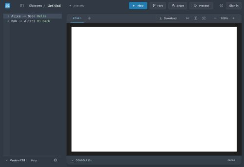
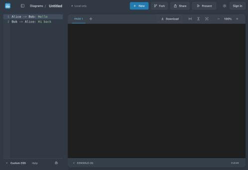
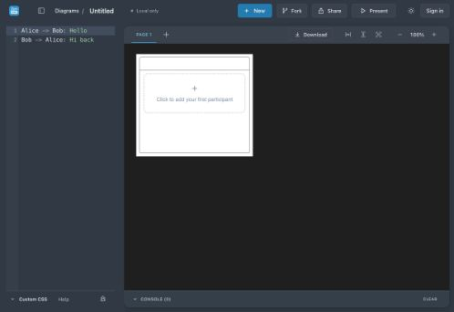
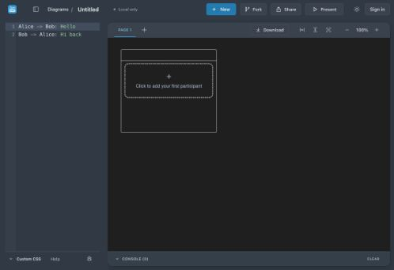

# Saved-dark host startup evidence

Captured 2026-10-21 using Chromium DevTools Tracing screenshots and requestAnimationFrame computed-style sampling. Cache disabled; 150 ms network latency, 500,000 bytes/s. Baseline: staging master feff3ba6. After: local production build on port 4460. These are separate environments, so timings are diagnostic, not a performance benchmark.

## Before

Saved dark preference is applied at 1688 ms. Iframe becomes available at 1722 ms with transparent body and displays white while loading core. Core default white canvas appears at 3700 ms; dark at 3726 ms.

## After

Saved dark appearance and host background are present at the first sampled state, 429 ms, before first paint at 952 ms. Iframe page is dark at 1832 ms and remains dark throughout core loading. A transient initial about:blank iframe was sampled before srcdoc parsed; filmstrip does not show a large white loading area.

**Remaining core issue:** constructor paints a white default canvas at 4307 ms; dark arrives at 4311 ms in this capture. The screenshots also show this white placeholder. No claim of zero white frames; core must accept initial appearance before construction to resolve this.

Dark-to-light toggle: startup style removed, canvas rgb(255,255,255), iframe body transparent. Saved-light reload begins with html/body rgb(239,246,251) at 412 ms, before first paint at 936 ms. See host-after-light-timeline.json.

Raw screenshot sequences and timeline JSON are retained. Screenshot 00 and frames immediately after a toggle may precede navigation; use the selected post-navigation frames above for comparison. No screenshots have been retouched.

Validation: 68 focused tests, TypeScript, production web build, MV3 extension build and git diff check pass. Default/invalid saved appearance stays light; no new system-preference behavior. Core remains official 4.8.1; no dependency patch, hiding or delayed reveal.
